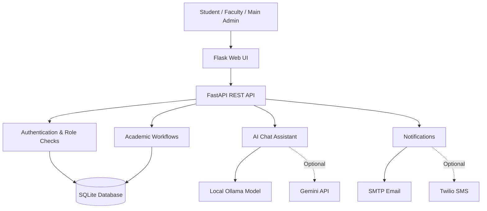

<div align="center">

# 🎓 SCMS-AI
### Smart College Management System

**A role-based college management platform with an AI assistant, academic workflows, and a modern web interface.**

<p>
  
  
  
  
</p>

<p>
  <a href="https://github.com/adityaraj150107-star/SCMS-AI">Repository</a> ·
  <a href="#-getting-started">Get Started</a> ·
  <a href="#-project-architecture">Architecture</a> ·
  <a href="#-author">Author</a>
</p>

</div>

---

## ✨ Overview

**SCMS-AI** is a college management project built to bring common academic and administrative workflows into one application. It combines a **Flask web interface**, a **FastAPI REST backend**, **SQLite persistence**, and an **AI chat assistant** that can connect to a local Ollama model or an optional Gemini API.

The project is intended for local development, learning, and demonstration. It is not presented as a production-certified student information system.

## 🚀 Key Features

| Area | What it includes |
|---|---|
| 🔐 Authentication | Sign-in, student/faculty registration, OTP verification, and role-aware access |
| 🎭 User roles | Student, Faculty, and Main Admin experiences |
| 📚 Academic workflows | Courses, semesters, subjects, enrollment, attendance, marks, assignments, submissions, and timetable APIs/UI |
| 📢 Communication | Notices, role-targeted notifications, and configurable email/SMS delivery |
| 🤖 AI assistant | Per-user chat history, quick prompts, optional voice input/output, and local Ollama or optional Gemini integration |
| 📎 File support | PDF, DOCX, and TXT uploads plus image preview; image OCR requires optional Tesseract |
| 📱 Responsive interface | Sidebar navigation, animated panels, mobile layouts, and dashboard counters |
| 🛠️ Administration | User creation, role updates, and account activation/deactivation |

## 🧰 Tech Stack

- **Frontend:** Flask web UI, HTML/CSS/JavaScript
- **Backend API:** FastAPI
- **Database:** SQLite
- **AI options:** Ollama (local) or optional Gemini API
- **Notifications:** SMTP email; optional Twilio SMS
- **Development:** Python 3.11+, VS Code, PowerShell

## 🏁 Getting Started

### Prerequisites

- Python **3.11 or newer**
- Git and VS Code recommended
- Ollama only if you want to run the local AI model
- SMTP/Twilio credentials only if you want real email/SMS delivery

### 1. Create and activate a virtual environment

Open PowerShell in the project folder:

```powershell
py -m venv .venv
.\.venv\Scripts\Activate.ps1
python -m pip install -r backend\requirements.txt
```

### 2. Configure environment variables

Copy the example configuration file:

```powershell
Copy-Item backend\.env.example backend\.env
```

Open `backend\.env` and configure the required settings, including strong values for:

- `FLASK_SECRET_KEY`
- `JWT_SECRET`
- `BOOTSTRAP_ADMIN_EMAIL`
- `BOOTSTRAP_ADMIN_PASSWORD`

Set up only the integrations you plan to use. **Never commit real API keys, passwords, tokens, or populated `.env` files to GitHub.**

### 3. Optional: set up local AI with Ollama

Install [Ollama](https://ollama.com), then download the configured model:

```powershell
ollama pull llama3.2
```

Ollama usually runs in the background. If required, start it in a separate terminal with `ollama serve`. If you prefer Gemini, configure its API key using your local environment settings instead.

### 4. Start the FastAPI backend

In terminal 1, from the project root:

```powershell
python -m uvicorn backend.main:app --reload --host 127.0.0.1 --port 8000
```

### 5. Start the Flask web interface

In terminal 2, activate the same virtual environment and run:

```powershell
py app.py
```

### 6. Open the application

| Service | Local URL |
|---|---|
| Flask web interface | [http://127.0.0.1:5000](http://127.0.0.1:5000) |
| FastAPI interactive docs | [http://127.0.0.1:8000/docs](http://127.0.0.1:8000/docs) |

> **First login:** The Main Admin account is bootstrapped using `BOOTSTRAP_ADMIN_EMAIL` and `BOOTSTRAP_ADMIN_PASSWORD` when the database is initialized. Use the values you configured locally.

## 🏗️ Project Architecture



## ⚙️ Optional Integrations

### Email OTP

Configure the SMTP settings in your local environment file, such as `SMTP_HOST`, `SMTP_PORT`, `SMTP_USER`, `SMTP_PASSWORD`, and `SMTP_FROM`. Gmail typically requires an **App Password**, not your normal account password.

### Development OTP fallback

`DEV_SHOW_OTP=true` may expose an OTP in the API response when email delivery fails, for local testing only. Disable it before sharing or deploying the application:

```env
DEV_SHOW_OTP=false
```

### SMS

Twilio SMS requires valid `TWILIO_ACCOUNT_SID`, `TWILIO_AUTH_TOKEN`, and `TWILIO_FROM_NUMBER` values, plus a recipient number with country code. A queued or failed notification does not guarantee delivery.

## 🔒 Security Notes

- Keep `.env`, API keys, SMTP passwords, tokens, and private credentials out of commits.
- Use a strong, unique secret for each environment.
- Do not use real student data in an unreviewed demo installation.
- Before internet-facing or institutional use, review HTTPS, CSRF protection, session/token handling, authorization rules, rate limiting, backups, logging, and data retention.
- Configure and test email/SMS providers separately; the application cannot guarantee external delivery.

## 📌 Current Scope & Limitations

- This is a local-development and demonstration project, not a certified production ERP.
- OTP and SMS delivery depend on external provider configuration.
- AI chat does not directly make official academic-record changes; use the relevant application workflows.
- Image preview is available, but full vision-model reasoning is not included in the current chat API. Image text extraction requires optional Tesseract.
- Faculty/admin permissions should be reviewed and adapted to the requirements of the institution before real-world use.

## 👨‍💻 Author

<div align="center">

### Aditya Raj

[](https://github.com/adityaraj150107-star)
[](https://adityaraj150107-star.github.io/Aditya_Raj_Portfolio/)

*Built as a college project to explore web development, APIs, database-backed workflows, and AI integration.*

</div>

---

<div align="center">
  <sub>If you find this project useful for learning, feel free to explore the code and adapt it for your own practice.</sub>
</div>
